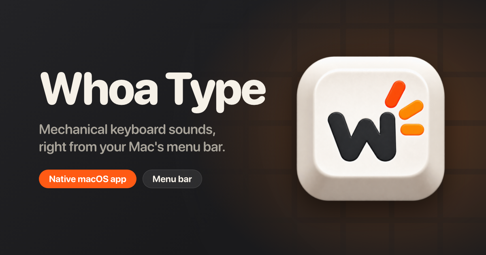

# Whoa Type



A native macOS menu bar app that plays mechanical-keyboard sounds as you type, plus click sounds for your mouse and trackpad. It uses SwiftUI, a listen-only Core Graphics event tap and an `AVAudioSourceNode` mixer. There are no third-party dependencies and no network access.

## Requirements

- macOS 26.5 or later, Apple Silicon or Intel.
- Input Monitoring permission (see [Permissions](#permissions)).
- To build from source: Xcode with the macOS 26 SDK (Swift tools 6.2+).

## Install

Download the versioned DMG from [GitHub Releases](https://github.com/WhoaStudio/whoa-type/releases), open it and drag Whoa Type to Applications.

Or install with Homebrew:

```sh
brew tap WhoaStudio/whoa-type https://github.com/WhoaStudio/whoa-type.git
brew install --cask WhoaStudio/whoa-type/whoa-type
open -a "Whoa Type"
```

Releases built without signing credentials are unsigned and not notarized, and their release notes say so. macOS may block those downloads from opening.

### First launch: opening an unsigned release

If macOS blocks Whoa Type, open it once from Applications, then go to **System Settings → Privacy & Security** and choose **Open Anyway** in the Security section. Confirm the prompt; macOS will remember the exception. See [Apple’s instructions](https://support.apple.com/102445).

## Using it

Whoa Type lives in the menu bar and starts with sound off.

1. Click the menu bar icon and open **Whoa Type Settings…**.
2. Grant Input Monitoring in the General pane, relaunch if macOS asks, then turn on **Play key and click sounds**.
3. Pick a switch set from the menu bar list. Hovering a row (after a short pause) previews it; clicking selects it.
4. Choose your keyboard layout (ANSI, ISO or JIS), mouse click sounds, the optional Return-key ding, and an optional global shortcut to toggle sounds.

Key position shapes the sound: the left of the keyboard sounds deeper and warmer, the right brighter, and Space, Return and Delete are heavier than modifiers. Mouse and trackpad buttons use a shared pool of press recordings, varied without immediate repeats, plus a release recording. Pointer movement, scrolling, pressure and gestures are never read.

## Permissions

Whoa Type needs **Input Monitoring** (System Settings → Privacy & Security → Input Monitoring) so it can hear key and button presses in other apps. It does not need Accessibility, Screen Recording or the microphone. It reads only physical key codes and press/release phases, never typed text or cursor position. See [privacy](Docs/PRIVACY.md).

Preview works without the permission and while sound is off.

## Troubleshooting

- **No sound:** check the menu bar toggle, the volume, and that Input Monitoring is enabled. Settings → General shows the permission state; **Check Again** re-reads it.
- **Sounds stop in password fields:** macOS Secure Input suppresses key events there. They resume when it ends.
- **Delay with Bluetooth headphones:** Bluetooth adds substantial, variable audio latency. Use a wired or built-in output for typing.
- **Reset Input Monitoring after replacing the app:** Quit Whoa Type, run `tccutil reset ListenEvent ugolin-olle.whoa-type`, then launch the Applications copy and grant access again.

## Uninstall

Quit Whoa Type from the menu bar, turn off **Start Whoa Type at login**, delete the app from Applications, and remove its Input Monitoring entry in System Settings.

## Build and test

```sh
xcodebuild -project whoa-type.xcodeproj -scheme whoa-type -destination 'platform=macOS' build
swift test
```

`swift test` runs the core Swift Testing suite, not UI or permission checks. Add `WHOA_AUDIO_INTEGRATION=1` to include the real audio-engine test. Everything requires macOS and Xcode; none of it builds on Linux. For a local universal DMG run `scripts/build-dmg.sh 1.2`; output is `build/release/WhoaType-1.2-macOS.dmg`. Local builds require an Apple Development signing identity. Public releases require Developer ID signing and notarization. See [distribution](Docs/DISTRIBUTION.md).

See [ARCHITECTURE.md](ARCHITECTURE.md) for module ownership and real-time contracts, and [validation](Docs/VALIDATION.md) for measured results and outstanding manual checks.

## Sound packs

Fifteen filename-based packs from the Neptune archive collection are bundled. Reproduce the import with `python3 Tools/import_soundpacks.py /path/to/zips`; existing destination folders are never overwritten. Each folder keeps the pack's `config.json` plus the prepared PCM samples (`prepared/`) and a `manifest.json` for the loader. The original recordings are not stored in the repository; the importer rebuilds from the source ZIPs.

The importer maps named Enter, Space/Spacebar, Backspace and Tab recordings to physical codes 36, 49, 51 and 48; other keys use fallback variants. Release recordings are used when `support-events` is true, otherwise release is silent. Switch names are descriptive labels, not hardware identifications.

## Releasing

From a clean `stable` branch that exactly matches `origin/stable`, run `scripts/release.sh 1.2` (one to three numeric components, no `v`). It bumps both Xcode version settings, commits, tags `v1.2` and pushes both atomically. The Release workflow checks the tag is on `stable`, runs the tests, builds the universal DMG, publishes it and commits the checksum to `Casks/whoa-type.rb`. Pull that cask commit before your next release. Setup details and signing secrets are in [distribution](Docs/DISTRIBUTION.md).

## License

Source code is under the [MIT license](LICENSE). Bundled recordings are excluded from that grant pending confirmation of their redistribution rights; see [distribution](Docs/DISTRIBUTION.md).
